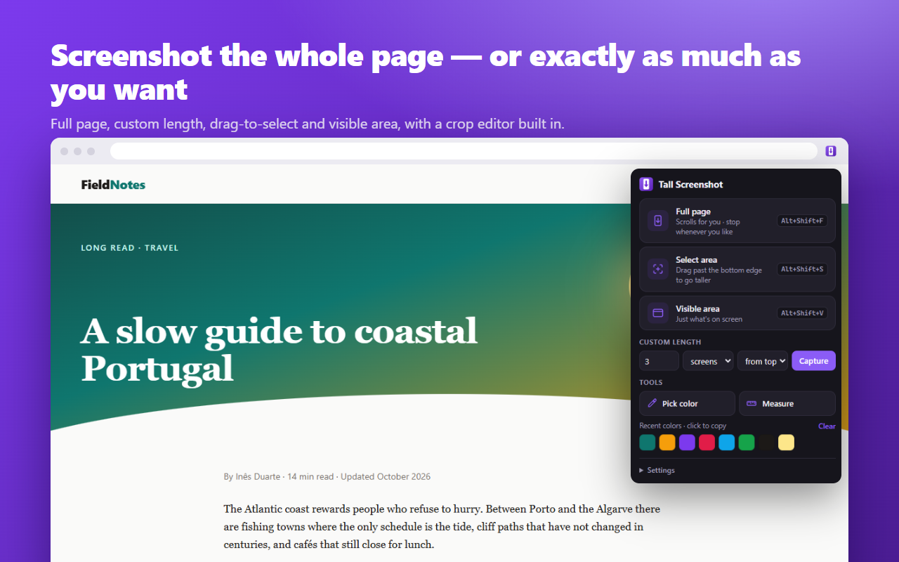

# Tall Screenshot

A fast Chrome extension for long screenshots. It can capture a full page, a length you choose, or an area you drag to any height, and it has a built-in editor to crop, copy and download. It also includes a **color picker** (like ColorZilla) and an **on-page ruler** (like Dimensions).

It works in Chrome, Edge, Brave, Opera, Arc and other Chromium browsers (Manifest V3, Chrome 116+).



## Install (developer mode)

1. Open `chrome://extensions` (in Edge: `edge://extensions`).
2. Turn on **Developer mode** (top-right).
3. Click **Load unpacked** and select this folder (the one with `manifest.json` directly inside it).
4. Pin it: click the puzzle icon in the toolbar, then the pin next to **Tall Screenshot**.

## Screenshots: you choose how long

| Mode | How to use it | Shortcut |
| --- | --- | --- |
| **Full page** | The page scrolls by itself. Click **Stop here & edit** (or press **Esc**, or click the toolbar icon) when you have enough. Otherwise it runs to the end of the page. | `Alt+Shift+F` |
| **Select area** | Drag a box. Drag past the bottom or top edge, or use the mouse wheel, to keep scrolling, so the box can be any height. **Esc** cancels. | `Alt+Shift+S` |
| **Custom length** | Type a length in *screens* or *px*, starting *from the top* or *from here* (your current scroll position). | – |
| **Visible area** | Captures just what's on screen, almost instantly. | `Alt+Shift+V` |

When a capture finishes, the editor opens in a new tab:

- **Crop** (`C`): drag on the image to draw a box, drag the handles to adjust it, or type exact X / Y / W / H values. Dragging near the top or bottom of the window scrolls. Press `Enter` to apply.
- **Undo** (`Ctrl+Z`) restores the previous crop without any quality loss.
- **Zoom**: `+` / `-`, `0` to fit, `1` for 100%, or `Ctrl` + mouse wheel.
- **Copy** (`Ctrl+C`) copies a PNG to the clipboard. **Download** (`Ctrl+S`) saves as PNG, JPG or WebP.

## Tools

**Pick color** (`Alt+Shift+C`): a magnifier follows the mouse and shows the exact pixel under it. Click (or press `Enter`) to copy the color. Arrow keys move one pixel at a time, `Shift` + arrows move 10. Colors are copied as HEX, RGB or HSL (choose under *Settings*). Your recent colors show in the popup; click a swatch to copy it again.

**Measure** (set a shortcut at `chrome://extensions/shortcuts`):

- **Move the mouse**: lines run to the nearest edges up, down, left and right, labeled with the width × height between them.
- **Drag a box**: when you let go, it snaps to the content inside it and shows its exact size.
- **Hold `Shift`**: shows the size of the element under the cursor, for example `button.primary 96 × 36`.

Sizes are in CSS pixels, the same units as your stylesheet, even on high-DPI or zoomed screens. Both tools work on images and video frames too, because they read the pixels on screen. You can scroll while a tool is open; press `Esc` or right-click to close it.

Everything above is also in the right-click menu under **Tall Screenshot**.

## Speed and quality

- Chrome allows extensions **2 screenshots per second**, so a page 10 screens tall takes about 5 seconds. The wait doubles as loading time for lazy images, and you can stop at any point.
- Fixed headers, sticky menus and cookie bars are shown **once**, not on every screen (you can turn this off under *Settings*).
- App-style pages that scroll an inner panel are detected automatically. This includes mail, chat and docs apps.
- For very slow sites, raise *Extra wait per screen* in *Settings*.
- Very tall captures are scaled down to fit the browser's image size limit (about 32,000 px). The editor tells you when this happens. Cropping a smaller part brings back full resolution.

## Privacy

Everything stays on your computer. Nothing is uploaded, and there is no analytics or tracking. See [PRIVACY.md](PRIVACY.md).

## Permissions

| Permission | Why |
| --- | --- |
| `activeTab` | Capture or inspect the tab you clicked the extension on, only when you ask. No access to other sites. |
| `scripting` | Scroll the page, show the selection overlay and run the color picker and ruler. |
| `storage` | Remember your settings and recent colors. |
| `contextMenus` | Right-click menu entries. |

## Project layout

```
manifest.json
icons/                 extension icons
src/background.js      service worker: starts captures and tools, grabs screenshots, stores frames
src/content.js         injected for screenshots: scrolling, fixed-header handling, selection overlay
src/inspect.js         injected for the color picker and ruler
src/color.js           HEX / RGB / HSL formatting shared by the picker and the popup
src/db.js              IndexedDB storage shared by the worker and the editor
src/settings.js        defaults + chrome.storage helpers
src/popup/             toolbar popup (modes, custom length, tools, recent colors, live progress)
src/editor/            stitching, crop, undo, zoom, copy and download
store/                 Chrome Web Store listing text and images
```

## Publishing

Run `scripts/package.ps1` (Windows PowerShell) to build `dist/tall-screenshot-<version>.zip`, the file you upload to the Chrome Web Store and Microsoft Edge Add-ons. The listing text, permission justifications and images are in [`store/`](store/).
